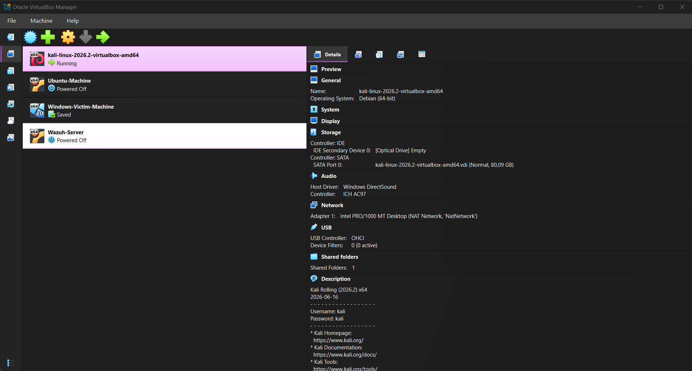
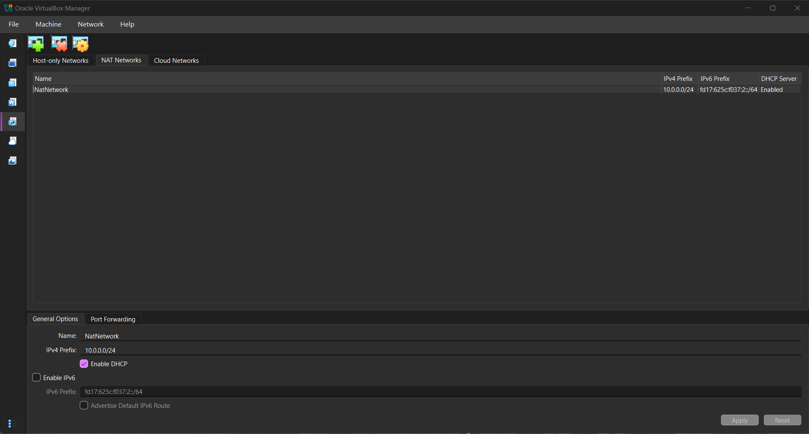
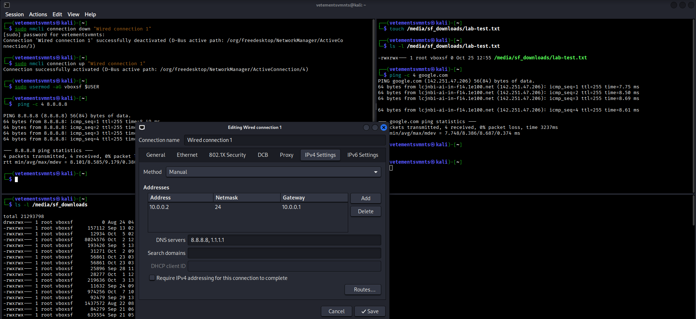
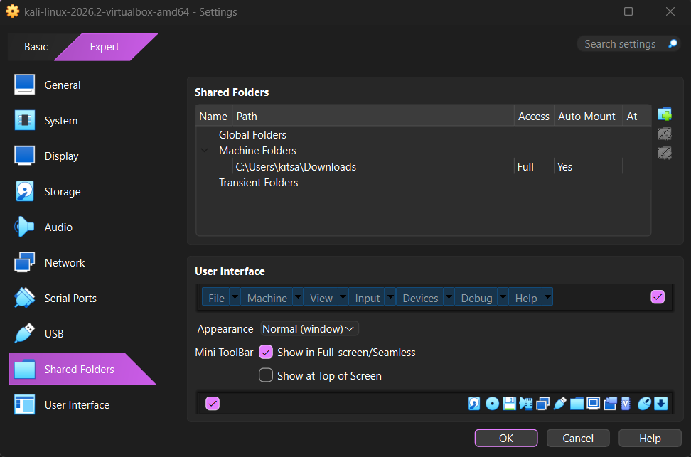
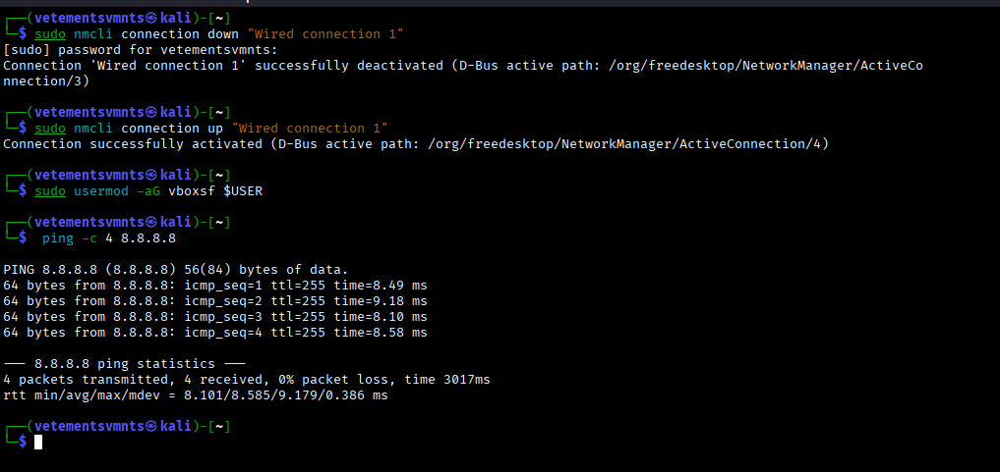
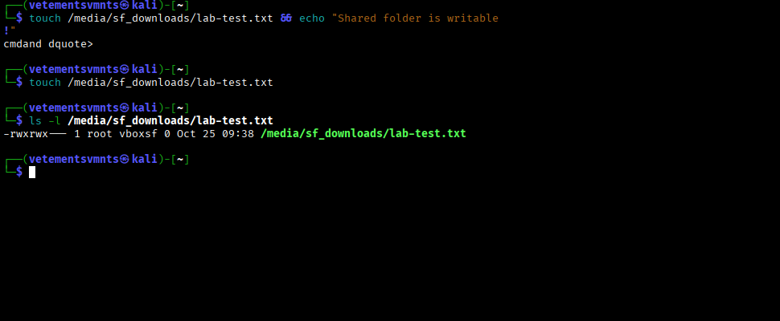

<div align="center">

# SecOps Simulation & Range Architecture

**A segmented, snapshot-driven virtual range for offensive tradecraft, detection engineering, and telemetry validation**
</div>

<p align="center">
  
  
  
  
  
  
  
  
  
  
</p>

---

## Executive Summary

This repository documents the design, build, and validation of a self-contained cyber range used for authorized offensive security assessment, target reconnaissance, vulnerability enumeration, and detection validation.

The range is built on a single VirtualBox **NAT Network** (`10.0.0.0/24`). Attacker, target, and monitoring nodes share one virtual switch, which allows east-west traffic between guests. The hypervisor performs NAT for outbound access, so nothing on the host LAN can reach the guests unless a port-forward is created explicitly. The design goal is a **repeatable baseline**: every node can be rolled back to a known-good snapshot in seconds, so each exercise starts from the same state.

The range supports an attack → detect → validate loop. Offensive activity from Kali against the target nodes generates telemetry, which is collected and analysed on the Wazuh server. This turns the lab into a purple-team environment rather than an attack-only sandbox.

---

## Objectives

| # | Objective | Outcome |
|---|-----------|---------|
| 1 | Provision a hypervisor and an attacker workstation | VirtualBox 7.2 and Kali Linux 2026.2 deployed |
| 2 | Build a dedicated, segmented lab network | NAT Network `10.0.0.0/24` with DHCP enabled and IPv6 disabled |
| 3 | Establish deterministic addressing | Static IPv4 on the attacker node, with a documented addressing convention for the rest |
| 4 | Verify L3 reachability and name resolution | Gateway, external IP, and DNS tests pass |
| 5 | Provide a controlled host ↔ guest file path | VirtualBox shared folder with explicit permissions |
| 6 | Establish recoverable baselines | Clean snapshots taken before any offensive activity |
| 7 | Prepare the range for target and telemetry integration | Ubuntu, Windows victim, and Wazuh nodes provisioned |

---

## Scope & Rules of Engagement

This range exists for learning, research, and authorized security testing. Only systems that you own, or have explicit written permission to test, are in scope. Tooling used here must never be pointed at third-party infrastructure. All intentionally vulnerable targets stay on the internal lab network and are never given bridged or public exposure.

---

## Lab Architecture



*Figure 1. VirtualBox Manager showing the range inventory: Kali (running), Ubuntu, Windows victim, and Wazuh server, all attached to one NAT Network.*

### Node Inventory

| Node | Role | State | Purpose |
|------|------|-------|---------|
| `kali-linux-2026.2-virtualbox-amd64` | Attacker | Running | Recon, enumeration, exploitation, and tooling |
| `Ubuntu-Machine` | Target / general-purpose Linux | Powered off | Linux services and misconfiguration targets |
| `Windows-Victim-Machine` | Target (Windows 10) | Saved | Windows attack surface and endpoint telemetry source |
| `Wazuh-Server` | Monitoring / SIEM | Powered off | Log aggregation, alerting, and detection validation |

### Host & Attacker Configuration

| Component | Configuration |
|-----------|---------------|
| Host OS | Windows 10 |
| Host CPU | Intel Core i7 |
| Host RAM | 8 GB |
| Hypervisor | VirtualBox 7.2 |
| Attacker OS | Kali Linux 2026.2 (Rolling) |
| Attacker RAM | 2048 MB |
| Attacker disk | 80 GB (dynamically allocated VDI) |
| Virtual NIC | Intel PRO/1000 MT Desktop |
| Virtual network | NAT Network `NatNetwork` |
| Network address | `10.0.0.0/24` |
| Attacker IP | `10.0.0.2/24` (static) |
| Default gateway | `10.0.0.1` |
| DNS | `8.8.8.8`, `1.1.1.1` |
| Reserved range for additional VMs | `10.0.0.3` – `10.0.0.99` |

### Addressing Convention

A predictable address plan keeps captured traffic, SIEM events, and report evidence easy to attribute. Suggested allocation within the reserved range:

| Range | Use |
|-------|-----|
| `10.0.0.1` | Gateway (VirtualBox) |
| `10.0.0.2` | Attacker (Kali) |
| `10.0.0.10 – 10.0.0.49` | Targets (Linux, Windows, and others) |
| `10.0.0.50 – 10.0.0.69` | Monitoring and security infrastructure (Wazuh) |
| `10.0.0.70 – 10.0.0.99` | Spare and experimental |

> **Note:** Static addresses should sit outside the lease range of the VirtualBox DHCP server to avoid collisions. Confirm the active range with `VBoxManage list dhcpservers` and adjust the convention above if they overlap.

### Resource Budget

The host has 8 GB of RAM, so the full range cannot run concurrently. Run only the nodes the current exercise needs, and use saved state or power-off for the rest.

| Exercise type | Nodes to run |
|---------------|--------------|
| Recon and enumeration against a Linux target | Kali + Ubuntu |
| Windows attack paths | Kali + Windows victim |
| Detection validation | Kali + Windows victim + Wazuh (monitor host memory closely) |

---

## Design Decisions

| Decision | Rationale | Trade-off |
|----------|-----------|-----------|
| **NAT Network** rather than plain NAT | Plain NAT isolates each VM from its peers. A NAT Network gives guests a shared switch (east-west traffic) while keeping NAT for outbound access. | Guests have outbound internet access by default. See [Security Considerations](#security-considerations). |
| **Static IP** on the attacker | Stable reference for documentation, listener configuration, and report evidence | Must be maintained outside the DHCP lease range |
| **Snapshot baseline before activity** | Exercises are repeatable, and destructive testing is cheap to undo | Snapshot chains grow disk usage and should be pruned |
| **Shared folder** for artefact transfer | Simple movement of wordlists, reports, and captures between host and guest | Creates a host ↔ guest trust boundary (see below) |
| **Wazuh in the same segment** | Low-friction agent enrolment and log forwarding for validation work | Monitoring and targets share a broadcast domain, so this is not a production-grade segmentation model |

---

## Build Procedure

### Step 1. Install tooling

Install **7-Zip** (the Kali VM image is distributed as a `.7z` archive) and **VirtualBox 7.2** on the host.

### Step 2. Create the NAT Network

Configuration:

```text
Network Name: NatNetwork
IPv4 Prefix:  10.0.0.0/24
DHCP:         Enabled
IPv6:         Disabled
```

GUI path: **File → Tools → Network Manager → NAT Networks**.



*Figure 2. NAT Network definition in VirtualBox Network Manager: `NatNetwork`, `10.0.0.0/24`, DHCP enabled, IPv6 disabled.*

The same network can be created reproducibly from the CLI:

```powershell
VBoxManage natnetwork add --netname NatNetwork --network "10.0.0.0/24" --enable --dhcp on
```

### Step 3. Import and attach Kali Linux

Download the prebuilt VirtualBox image from the official Kali site and import it. Attach the adapter to the NAT Network:

```text
Adapter 1
Attached to:  NAT Network
Name:         NatNetwork
Adapter Type: Intel PRO/1000 MT Desktop
RAM:          2048 MB
```

> **Hardening note:** the prebuilt Kali image ships with default credentials documented in the VM description field. Create a named user and retire or change the defaults before the VM is used for anything beyond initial setup.

### Step 4. Configure static addressing

The connection can be edited in the NetworkManager GUI, or scripted. The scripted form is preferred because it is reproducible:

```bash
# Identify the real connection name first (it may differ per system)
nmcli connection show

sudo nmcli connection modify "Wired connection 1" \
  ipv4.method manual \
  ipv4.addresses 10.0.0.2/24 \
  ipv4.gateway 10.0.0.1 \
  ipv4.dns "8.8.8.8 1.1.1.1" \
  ipv4.dad-timeout 0

sudo nmcli connection down "Wired connection 1"
sudo nmcli connection up   "Wired connection 1"
```



*Figure 3. Manual IPv4 configuration on the Kali node (`10.0.0.2/24`, gateway `10.0.0.1`, DNS `8.8.8.8, 1.1.1.1`), shown with the connection cycle and the shared folder listing.*

### Step 5. Configure the shared folder

A host directory is shared into Kali with auto-mount enabled. In VirtualBox: **Settings → Shared Folders → Add**, then confirm the mount point inside the guest.

```text
Host path:    C:\Users\<user>\Downloads
Access:       Full
Auto-mount:   Yes
Guest mount:  /media/sf_downloads
```

The guest user must belong to the `vboxsf` group to access the mount. Log out and back in after the change:

```bash
sudo usermod -aG vboxsf $USER
```



*Figure 4. Shared folder definition in the VM settings: host Downloads directory, full access, auto-mount enabled.*

### Step 6. Capture the clean baseline snapshot

Take the baseline only after networking and shared-folder access have been verified.

```text
Snapshot name: Clean Kali - Network Setup
```

CLI equivalent:

```powershell
VBoxManage snapshot "kali-linux-2026.2-virtualbox-amd64" take "Clean Kali - Network Setup" --description "Static IP, NAT Network, shared folder verified"
```

If an exercise corrupts or contaminates the VM, restore this snapshot and carry on.

---

## Validation

Every claim in the build is backed by a test. Run these after any network change and after restoring a snapshot.

| Layer | Test | Command | Expected result |
|-------|------|---------|-----------------|
| L3 addressing | Interface address | `ip -br a` | `10.0.0.2/24` on the primary interface |
| L3 routing | Default route | `ip route` | Default via `10.0.0.1` |
| L3 reachability | Gateway | `ping -c 4 10.0.0.1` | 0% packet loss |
| Egress | External IP | `ping -c 4 8.8.8.8` | 0% packet loss |
| Name resolution | DNS | `ping -c 4 google.com` or `dig github.com` | Name resolves, replies received |
| Tooling | Nmap present | `nmap --version` | Version displayed |
| Shared folder | Group membership and write | `id \| grep vboxsf` then `touch /media/sf_downloads/lab-test.txt` | File created and visible on the host |
| Recovery | Snapshot restore | Restore baseline, then `ip -br a` | Baseline configuration restored |



*Figure 5. Connection cycled with `nmcli`, `vboxsf` group membership applied, and external reachability confirmed (4/4 replies from 8.8.8.8, 0% loss).*



*Figure 6. Shared folder write test: the first attempt hangs at a `dquote>` prompt because zsh expands `!` inside double quotes. The retry succeeds, and `ls -l` confirms `lab-test.txt` exists on the `root:vboxsf` mount.*

### Observed Results

```text
Kali IP:        10.0.0.2/24
Gateway:        10.0.0.1
DNS:            8.8.8.8, 1.1.1.1
ping 8.8.8.8:   4/4 received, 0% loss, avg ~8.6 ms
ping google.com: 4/4 received, 0% loss, avg ~8.7 ms
Shared folder:  /media/sf_downloads writable (lab-test.txt created)
```

---

## Troubleshooting Log

Recording faults and root causes is part of the deliverable.

### 1. No connectivity after applying a static IP

**Symptom:** Static IPv4 applied, but traffic fails or the link takes a long time to come up.
**Cause:** NetworkManager's IPv4 duplicate-address detection (DAD) delays or blocks activation on the virtual NIC.
**Fix:** Disable the DAD wait on the connection, then cycle it:

```bash
sudo nmcli connection modify "Wired connection 1" ipv4.dad-timeout 0
sudo nmcli connection down "Wired connection 1" && sudo nmcli connection up "Wired connection 1"
```

> Connection names differ between systems. Always run `nmcli connection show` first.

### 2. VM fails to start: VT-x / hardware virtualization error

**Symptom:** VirtualBox refuses to start the VM with a VT-x or AMD-V error.
**Cause:** Hardware virtualization was disabled in firmware.
**Fix:** Enter BIOS/UEFI, enable Intel VT-x, save, and reboot. On Windows hosts, also confirm that no other hypervisor feature (Hyper-V, WSL2, Memory Integrity) is conflicting if the error persists.

### 3. Shell hangs on a `dquote>` prompt

**Symptom:** A command such as `touch file && echo "Shared folder is writable!"` drops into a `cmdand dquote>` continuation prompt (see Figure 6).
**Cause:** In zsh (Kali's default shell), `!` inside double quotes triggers history expansion, leaving the string unterminated.
**Fix:** Use single quotes, or drop the exclamation mark:

```bash
touch /media/sf_downloads/lab-test.txt && echo 'Shared folder is writable'
```

### 4. Permission denied on the shared folder

**Symptom:** The mount exists at `/media/sf_downloads` but the user cannot read or write.
**Cause:** The mount is owned by `root:vboxsf` with mode `rwxrwx---`, so only `vboxsf` group members have access.
**Fix:** `sudo usermod -aG vboxsf $USER`, then log out and back in so the new group is picked up.

---

## Security Considerations

A lab used for offensive work is itself an attack surface. These are the trust boundaries and the controls applied to them.

| Boundary | Risk | Control |
|----------|------|---------|
| **Outbound NAT** | A NAT Network is segmented from the host LAN, but not air-gapped. Guests, including vulnerable targets and any malware being studied, have outbound internet access. | For malware analysis or anything that must not phone home, move the target to a VirtualBox **Internal Network** with no egress. |
| **Shared folder** | Auto-mounted, full-access share of a host directory gives a compromised guest a path to host data. | Share a dedicated, empty directory rather than `Downloads`. Use read-only access where possible. Do not enable on target VMs. |
| **Default credentials** | The prebuilt Kali image documents its default login. | Use a named account and change defaults. |
| **Inbound exposure** | A port-forward on the NAT Network exposes a guest service to the host side. | Create none unless required and remove afterwards. Never forward vulnerable services. |
| **Snapshot hygiene** | Snapshots can preserve credentials, tokens, and loot. | Take baselines before engagements, and prune or delete snapshots that contain engagement data. |
| **Vulnerable targets** | Intentionally vulnerable VMs must never be reachable from outside the lab. | Keep NICs on `NatNetwork` only. Never bridge a target adapter. |

---

## Roadmap

- Enrol the Windows victim and Ubuntu nodes as Wazuh agents and baseline normal telemetry.
- Add Sysmon on Windows and map detections to MITRE ATT&CK techniques for each exercise.
- Stand up a Windows Server domain controller and run Active Directory attack paths (Kerberoasting, AS-REP roasting, lateral movement).
- Add a network sensor (Suricata or Zeek) on the segment for packet-level detection.
- Split the range into separate attacker, target, and monitoring networks behind a virtual firewall (pfSense/OPNsense) for true segmentation.
- Automate builds with Packer, Vagrant, or Ansible so the whole range is reproducible from code.
- Produce one write-up per exercise: attack path, telemetry generated, detection gaps, and remediation.

---

## Tools & Resources

- **7-Zip:** [https://7-zip.org/download.html](https://7-zip.org/download.html)
- **VirtualBox:** [https://virtualbox.org/wiki/Downloads](https://virtualbox.org/wiki/Downloads)
- **Kali Linux:** [https://kali.org/get-kali](https://kali.org/get-kali)
- **Wazuh:** [https://wazuh.com](https://wazuh.com)
- **MITRE ATT&CK:** [https://attack.mitre.org](https://attack.mitre.org)

---

## Acknowledgements

The baseline lab methodology was adapted from the NetworkWalks lab guide by Waqas Karim, CCIE. Architecture extensions, security analysis, and monitoring integration are my own work.

---

## Author

**Kitsana Thuekoh**
Penetration Tester & Offensive Security Researcher

GitHub: [vetementsvmnts](https://github.com/vetementsvmnts)
LinkedIn: [linkedin.com/in/kitsana-thuekoh-66ba9b314](https://linkedin.com/in/kitsana-thuekoh-66ba9b314/)

---

<div align="center">
<sub>For authorized security research and education only.</sub>
</div>
