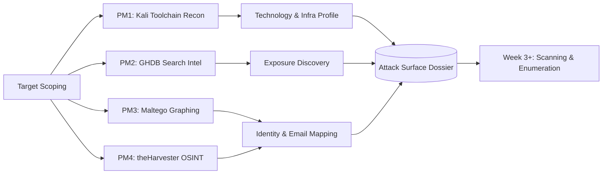

<div align="center">

```
██╗    ██╗███████╗███████╗██╗  ██╗    ██████╗
██║    ██║██╔════╝██╔════╝██║ ██╔╝    ╚════██╗
██║ █╗ ██║█████╗  █████╗  █████╔╝      █████╔╝
██║███╗██║██╔══╝  ██╔══╝  ██╔═██╗     ██╔═══╝
╚███╔███╔╝███████╗███████╗██║  ██╗    ███████╗
 ╚══╝╚══╝ ╚══════╝╚══════╝╚═╝  ╚═╝    ╚══════╝
   FOOTPRINTING  &  RECONNAISSANCE  OPERATIONS
```

**Network-Walks B084 · Offensive Security Programme · Week 2**


</div>

---

## `> whoami`

| | |
|---|---|
| **Operator** | Kitsana Thuekoh ([@vetementsvmnts](https://github.com/vetementsvmnts)) |
| **Role** | Penetration Tester · Offensive Security Researcher |
| **Credentials** | OSCP · HTB CPTS · CompTIA PenTest+ · Security+ · ISC2 CC |
| **Programme** | Network Walks – Cybersecurity & Ethical Hacking (Batch B084) |
| **Engagement** | Week 2 – Footprinting & Reconnaissance |

---

## `> executive summary`

Reconnaissance determines the quality of everything that follows. This module documents a structured intelligence-gathering exercise across **five project modules**, combining command-line tooling, search-engine intelligence (GHDB), graph-based OSINT (Maltego) and automated harvesting (theHarvester).

The primary lab target, **`networkwalks.com`**, was profiled end to end: registrar and ownership, hosting provider, DNS and mail architecture, web technology stack with versions, edge protection, and exposed application endpoints. **No exploitation was performed.** Every finding below was derived from information the target already publishes, which is the point: a determined adversary needs no special access to build this picture.

**Bottom line:** the target presents a *moderate, avoidable* external footprint. Version disclosure, an exposed REST API surface, a shared-hosting fingerprint and a soft-fail SPF policy would each shorten an attacker's planning phase. None is critical alone; together they form a clean attack-planning dossier.

---

## `> engagement map`



---

## `> repository index`

| Module | Focus | Tooling | Evidence |
|:---:|---|---|:---:|
| [**W2-PM1**](./W2-PM1) | Multi-tool footprinting of the target | `whois` `whatweb` `nslookup` `curl` `wafw00f` `dnsrecon` | Screenshots + raw output |
| [**W2-PM2**](./W2-PM2) | Search-engine intelligence | Google Hacking Database, Exploit-DB, Google dorks | Dork log |
| [**W2-PM3**](./W2-PM3) | Graph-based OSINT | Maltego Graph (Windows), Utilities transforms | Entity graph |
| [**W2-PM4**](./W2-PM4) | Automated email / sub-domain harvesting | `theHarvester` 4.10 (Baidu, all sources) | Terminal output |
| [**W2-PM5**](./W2-PM5) | _Module deliverable_ | _see folder_ | _see folder_ |

---

## `> rules of engagement`

> All activity was performed in a training context against targets designated by the programme, using **non-intrusive, read-only techniques**.

- ✅ Passive and low-noise collection only. No exploitation, brute force, credential attacks or denial of service.
- ✅ Targets restricted to programme-designated lab assets and public OSINT sources.
- ✅ No authentication attempted against any discovered third-party system. Search-engine discovery is documented as *methodology*; third-party hosts are intentionally **not** listed in this repository.
- ✅ Maltego email enumeration run against the course domain with permission, per the module brief.
- ⚠️ Techniques here must only be used against systems you own or hold **written authorisation** to test.

---

## `> PM1 · target profile: networkwalks.com`

### Intelligence collected

| Layer | Tool | Observation |
|---|---|---|
| **Registration** | `whois` | Registrar GoDaddy · created **2019-11-06** · expires **2027-11-06** · standard client-side transfer/update/delete locks set · **DNSSEC: unsigned** |
| **Hosting** | `whois` · `nslookup` | Name servers `ns6135/ns6136.hostgator.com` → shared hosting provider · resolves to **192.232.216.135** |
| **Web server** | `whatweb` · `curl -I` | Apache · HTTP→HTTPS 301 redirect · HTTP/2 · `x-nginx-cache: WordPress` header indicates a caching layer in front |
| **CMS** | `whatweb` | WordPress with **WP Download Manager 3.3.58** and exact version strings exposed in the generator tag |
| **Frontend** | `whatweb` | Bootstrap 7.0.4 string, jQuery 3.7.1, HTML5, Open Graph |
| **Endpoints** | `curl -I` | WordPress REST API advertised via `Link` header (`/wp-json/`) |
| **Cookies** | `curl -I` | `__wpdm_client` set with `Secure` and `HttpOnly` ✔ |
| **Edge protection** | `wafw00f` | **ModSecurity (SpiderLabs)** WAF detected after 2 requests |
| **DNS** | `dnsrecon` | SOA, NS, MX (`mail.networkwalks.com`), A, SPF TXT, Google site-verification TXT, 8 cPanel SRV autodiscover records · **BIND 9.16.23** banner disclosed |
| **Contact data** | `whatweb` · Maltego | `info@networkwalks.com` publicly harvestable |

### Command log

```bash
whois networkwalks.com
whatweb networkwalks.com
nslookup networkwalks.com
curl -I https://networkwalks.com
wafw00f networkwalks.com
dnsrecon -d networkwalks.com
```

---

## `> findings & risk register`

> Ratings are my assessment of **external attack-surface exposure**, not confirmed vulnerabilities. No exploitation was attempted.

| ID | Finding | Evidence | Rating | Why it matters |
|:---:|---|---|:---:|---|
| F-01 | Software version disclosure (CMS, plugin, DNS daemon) | `whatweb`, `dnsrecon` | 🟠 **Medium** | Exact versions let an attacker pivot straight to CVE and exploit-database lookups, skipping fingerprinting. |
| F-02 | WordPress REST API discoverable | `curl -I` `Link` header | 🟡 **Low** | Confirms CMS and gives a clean entry point for user and route enumeration. |
| F-03 | Shared hosting fingerprint | `whois` NS, `nslookup` | 🟡 **Low** | Reveals provider and neighbouring-tenant risk; informs hosting-specific attack paths. |
| F-04 | SPF policy ends in soft-fail (`~all`) | `dnsrecon` TXT | 🟡 **Low** | Weaker spoofing resistance than hard-fail; useful to a phishing operator. |
| F-05 | DNSSEC not enabled | `whois` | 🔵 **Info** | Resolver-level tampering protection absent; common but worth noting. |
| F-06 | Public role mailbox exposed | `whatweb`, Maltego | 🔵 **Info** | Phishing and password-spray target. Standard for public sites, so mitigate with MFA and filtering. |
| F-07 | cPanel autodiscover SRV records published | `dnsrecon` | 🔵 **Info** | Signals control-panel hosting and mail stack layout. |
| F-08 | WAF present (ModSecurity) | `wafw00f` | 🟢 **Positive** | Raises attacker cost; confirms a defensive layer exists. |
| F-09 | Cookies flagged `Secure` + `HttpOnly` | `curl -I` | 🟢 **Positive** | Good baseline session-cookie hygiene. |

---

## `> PM2 · search-engine intelligence`

GHDB dorks, hosted on Exploit-DB, convert Google into a quiet reconnaissance engine. The module exercised the full workflow: select a dork category → validate syntax → run → triage results → record dork and finding.

```text
intitle:index.of "parent directory" mathematics pdf     # open directory listings
intitle:"webcamXP" inurl:8080                           # exposed device-management pages
```

**Key takeaway.** Search engines index what owners forget to protect. The defensive mirror of this technique, running the same dorks against your *own* domains, is a cheap and effective exposure check. Third-party device results are deliberately excluded from this repository.

---

## `> PM3 · Maltego graph OSINT`

- Installed and activated **Maltego Graph 4.11.3** on Windows (JRE 17 prerequisite handled by the installer).
- Seeded a `Domain` entity with `networkwalks.com` and ran Utilities email transforms (`To Email address [From whois info]`, `To Emails @domain [Search Engine]`).
- Result: the organisation's public mailbox surfaced as a linked entity on the graph.

**Operator note.** Maltego's value is *relationships*, not single data points. Pivoting from domain → email → person → infrastructure is how isolated facts become an actionable target model.

---

## `> PM4 · theHarvester`

```bash
# Task 1 · single source, high result ceiling
theHarvester -d microsoft.com -l 1000 -b baidu

# Task 2 · all sources, constrained result set
theHarvester -d microsoft.com -l 50 -b all
```

| Run | Source | Outcome |
|---|---|---|
| Task 1 | Baidu | 1 email surfaced (a no-reply service address), no hosts or IPs returned |
| Task 2 | All | Many modules returned *missing API key* errors, so keyed sources (BeVigil, Bitbucket, BuiltWith, Brave and others) did not contribute |

**Lessons learned**

1. **Source choice drives yield.** A single engine can return almost nothing; coverage comes from combining sources.
2. **API keys are force multipliers.** An unconfigured `api-keys.yaml` silently caps capability. A production engagement should provision keys up front.
3. **Results drift.** Upstream sources change constantly, so outputs should be timestamped and re-run rather than treated as static.

---

## `> defensive recommendations`

| Priority | Action |
|:---:|---|
| 1 | **Suppress version banners**: hide WordPress generator meta, plugin versions and the DNS daemon version string (`version "none";` in BIND). |
| 2 | **Restrict the REST API**: limit user enumeration and unauthenticated route listing; remove the `Link` header advertisement if the API is unused publicly. |
| 3 | **Tighten email authentication**: move SPF toward `-all`, and publish **DKIM** and **DMARC** with an enforcing policy. |
| 4 | **Enable DNSSEC** at the registrar where supported. |
| 5 | **Harden the mailbox surface**: enforce MFA, rate-limit login, and route role addresses through filtering. |
| 6 | **Patch cadence**: track WordPress core and plugin advisories; automate updates for the download-manager plugin. |
| 7 | **Run recon on yourself, regularly**: this exact toolchain, scheduled, is the cheapest external attack-surface monitor available. |

---

## `> tradecraft takeaways`

- **Recon is the force multiplier.** Time invested here removes guesswork from every later phase.
- **Tool agreement builds confidence.** The IP, provider and stack were each confirmed by at least two independent sources before being treated as fact.
- **Defenders see what attackers see.** The most useful framing of footprinting is as a *self-audit*.
- **Evidence discipline matters.** Every command, timestamp and screenshot is preserved so findings are reproducible and reportable.

---

## `> next phase`

```text
[✓] Reconnaissance & footprinting          <- you are here
[ ] Scanning & enumeration (Nmap, service/version detection)
[ ] Vulnerability analysis
[ ] Controlled exploitation (in lab scope)
[ ] Reporting & remediation
```

---

<div align="center">

**Kitsana Thuekoh** · Penetration Tester & Offensive Security Researcher
[GitHub](https://github.com/vetementsvmnts) · Johannesburg, South Africa

<sub>Educational material produced within the Network Walks programme. Use only against systems you own or are explicitly authorised to test.</sub>

</div>
