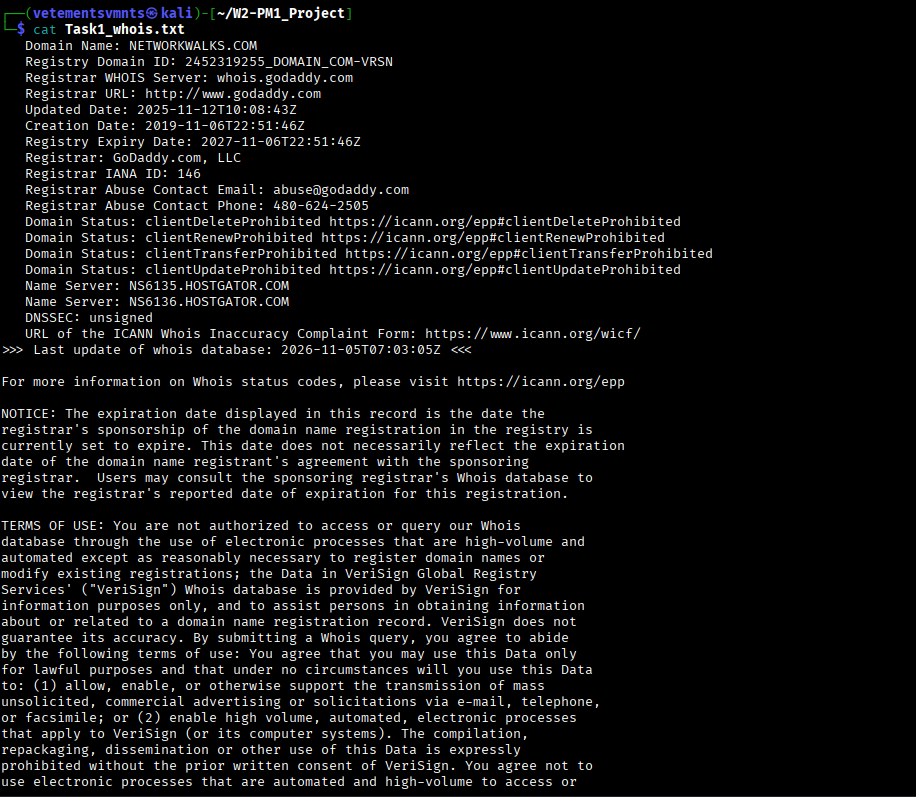
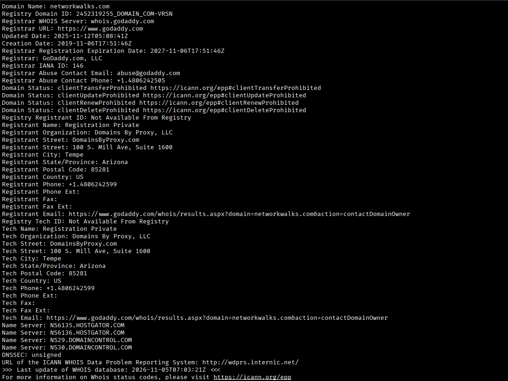
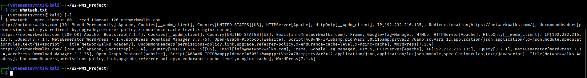
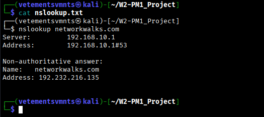
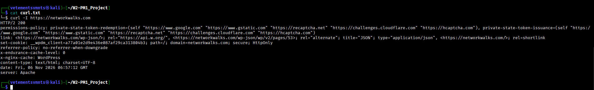
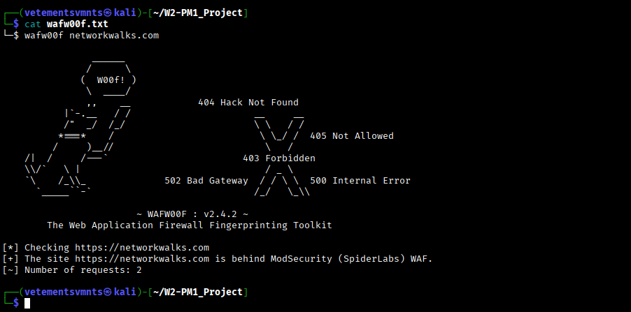
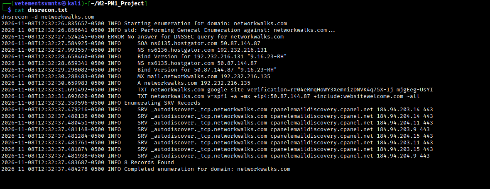

<div align="center">

# Penetration Testing Report 

### Footprinting & Network Scanning Phases

**W2-PM-FINAL · Cybersecurity · Networkwalks**


</div>

---

## Report Details

| Field | Detail |
|---|---|
| **Pentester** | Emmanuel Bafi |
| **Program / Batch** | B082-Networkwalks |
| **Report date** | 17 August 2026 |
| **Evidence captured** | 14 August 2026 (per tool and server timestamps in the screenshots) |
| **Modules completed** | W2-PM1 (Multiple Kali Tools) · W2-PM5 (Zenmap Scanning) |
| **Targets** | 1. `networkwalks.com` (written permission secured)<br>2. My own local LAN |
| **Permission secured?** |  Yes |
| **Phases covered** | **Phase 1:** Reconnaissance & Footprinting<br>**Phase 2:** Scanning & Network Discovery<br>**Phases 3–5:** In progress |

## 📑 Table of Contents

1. [Liability Disclaimer](#1-liability-disclaimer)
2. [Introduction](#2-introduction)
3. [Tools Used](#3-tools-used)
4. [Activities Performed](#4-activities-performed)
   - [4.1 Footprinting & Reconnaissance](#41-footprinting--reconnaissance)
   - [4.2 Network Scanning with Zenmap](#42-network-scanning-with-zenmap)
5. [Risk Analysis / Impact](#5-risk-analysis--impact)
6. [Recommendations](#6-recommendations)
7. [Conclusion](#7-conclusion)

---

## 1. Liability Disclaimer

> I performed these activities only on systems and devices where I had written permission, or on devices I own. All material here is for **education and research purposes only**. Do not use anything here to break the law.
>
> The instructor, the authors and Networkwalks & partners are not responsible for what you do with this knowledge. Every action you take is your own responsibility. Misuse can lead to criminal charges, heavy fines, loss of employment and a permanent record. In most countries, unauthorised access is a crime even when nothing is damaged.
>
> **Hacking is only legal when:**
> - You test a device or network that you own, or your lab environment
> - You have written and documented permission from the owner
> - You are working as a security professional under a signed agreement with an agreed scope
>
> Everything outside these cases is illegal.

## 2. Introduction

This report covers footprinting the `networkwalks.com` domain with multiple Kali Linux tools (**W2-PM1**) and scanning my own local network with Zenmap (**W2-PM5**). One module covers footprinting and the other covers scanning, so together they show how an attacker moves from gathering public information to mapping live hosts on a network. This is the Week 2 deliverable of my internship program at Networkwalks.

Footprinting was done in Kali Linux; scanning was done on a Windows PC with Zenmap installed. Every step includes the command used, what I observed, a screenshot as evidence, and a short note on why the finding matters from an attacker's point of view.

**Nature of the activity.** The course material describes footprinting as reading public information without touching the target. That holds for `whois` and `nslookup`, which query public registration and DNS data. `whatweb`, `curl -I`, `wafw00f` and `dnsrecon` go a step further: they send a small number of direct requests to the target's web and DNS servers (for example, `wafw00f` reported **2 requests**). That is why written permission matters even for low-impact reconnaissance.

## 3. Tools Used

| Tool | Purpose |
|---|---|
| **Kali Linux & Windows** | Operating systems used for reconnaissance and scanning |
| **WHOIS** | Domain registration details (registrar, dates, name servers) |
| **whatweb** | Fingerprint web technologies (server, CMS, plugins, IP) |
| **nslookup** | Resolve the domain name to its IP address via DNS |
| **curl -I** | Read the HTTP response headers of the website |
| **wafw00f** (v2.4.2) | Detect whether a Web Application Firewall protects the site |
| **dnsrecon** | Enumerate DNS records (SOA, NS, MX, A, TXT/SPF, SRV) |
| **Zenmap (Nmap GUI)** | Scan the local subnet for live hosts, IPs and MAC addresses |
| **Windows CMD** | Identify local IP address, subnet mask and MAC address |

## 4. Activities Performed

### 4.1 Footprinting & Reconnaissance

I ran reconnaissance against `networkwalks.com` using six Kali Linux tools. Each one gathered a different type of information.

#### 🔎 WHOIS: domain registration

```bash
whois networkwalks.com
```

**Observation:**

| Field | Value |
|---|---|
| Domain name | `NETWORKWALKS.COM` |
| Registrar | GoDaddy.com, LLC (IANA ID 146) |
| Creation date | 2019-11-06 |
| Last updated | 2025-11-12 |
| Registry expiry date | 2027-11-06 |
| Name servers | `NS6135.HOSTGATOR.COM`, `NS6136.HOSTGATOR.COM` |
| DNSSEC | Unsigned |
| Domain status | `clientDeleteProhibited`, `clientRenewProhibited`, `clientTransferProhibited`, `clientUpdateProhibited` |
| Registrar abuse contact | `abuse@godaddy.com` · 480-624-2505 |

**Why it matters:** The name servers point to HostGator, so the hosting provider is identified immediately. Registration dates and abuse contacts can support social engineering and attack planning.



<details>
<summary>Additional WHOIS output</summary>



</details>

#### 🧩 WhatWeb: technology fingerprinting

```bash
whatweb networkwalks.com
```

**Observation:**

| Item | Value |
|---|---|
| HTTP behaviour | `http://` returns **301 Moved Permanently** to `https://`, which returns **200 OK** |
| Web server | Apache |
| CMS | **WordPress 7.0.4** |
| Plugin | **WordPress Download Manager 3.3.58** |
| JavaScript library | jQuery 3.7.1 |
| Page title | Networkwalks Academy |
| IP address | `192.232.216.135` |
| Country | United States |
| Email address | `info@networkwalks.com` |
| Cookie | `__wpdm_client` (HttpOnly) |
| Other headers flagged | `permissions-policy`, `referrer-policy`, `x-endurance-cache-level`, `x-nginx-cache` and others |

**Why it matters:** Exact software versions let an attacker look up known exploits in vulnerability databases. The output also leaks the server IP address and a contact email address.



#### 🌐 Nslookup: DNS resolution

```bash
nslookup networkwalks.com
```

**Observation:** Using the resolver `8.8.8.8` (port 53), the domain resolved to **`192.232.216.135`** as a non-authoritative answer.

**Why it matters:** Knowing the real IP address lets an attacker scan the server directly, look up other sites on the same IP, and map the target's infrastructure.



#### 📨 Curl: HTTP headers

```bash
curl -I https://networkwalks.com
```

**Observation:**

| Header | Value / note |
|---|---|
| Status | `HTTP/2 200` |
| `server` | Apache |
| `link` | Exposes the WordPress REST API at **`/wp-json/`** (and `/wp-json/wp/v2/pages/53`) |
| `set-cookie` | `__wpdm_client`, with `secure` and `HttpOnly` attributes |
| `x-nginx-cache` | `WordPress` |
| `x-endurance-cache-level` | `0` |
| `referrer-policy` | `no-referrer-when-downgrade` |
| `content-type` | `text/html; charset=UTF-8` |
| `date` | Fri, 14 Aug 2026 21:33:17 GMT |

**Why it matters:** Headers leak the web server, the caching stack and hidden endpoints. An attacker can fingerprint the stack and find entry points without loading the full page.



#### 🛡️ Wafw00f: WAF detection

```bash
wafw00f networkwalks.com
```

**Observation:** wafw00f (v2.4.2) checked `https://networkwalks.com` and reported that the site is behind **ModSecurity (SpiderLabs)** WAF, using **2 requests**.

**Why it matters:** Knowing a WAF is present shapes the whole attack. Naive attempts are likely to be blocked or logged, so an attacker must adapt or try to bypass it.



#### 🧭 DNSRecon: DNS enumeration

```bash
dnsrecon -d networkwalks.com
```

**Observation:**

| Record | Result |
|---|---|
| SOA | `ns6135.hostgator.com` (`50.87.144.87`) |
| NS | `ns6135.hostgator.com` (`50.87.144.87`), `ns6136.hostgator.com` (`192.232.216.131`) |
| DNS software | **BIND 9.16.23-RH** reported on both name servers |
| MX | `mail.networkwalks.com` → `192.232.216.135` |
| A | `networkwalks.com` → `192.232.216.135` |
| TXT (SPF) | `v=spf1 +a +mx +ip4:50.87.144.87 +include:websitewelcome.com ~all` |
| TXT (verification) | A `google-site-verification` record |
| SRV | 8 `_autodiscover._tcp` records pointing to `cpanelemaildiscovery.cpanel.net` (`184.94.203.x` / `184.94.204.x`, port 443) |
| DNSSEC | No answer to the DNSSEC query, consistent with the WHOIS status of *unsigned* |

**Why it matters:** The DNS footprint exposes the mail server, the DNS software version, the SPF policy and the cPanel service records. Each record helps an attacker understand the email and hosting setup, and each can be a potential foothold.



---

### 4.2 Network Scanning with Zenmap

For the second activity I used **Zenmap** to discover hosts on my local network. The practical required me to:

1. Install Nmap and Zenmap on a Windows PC
2. Identify my local IP address and subnet
3. Discover live hosts, and record how many there are
4. Record their IP and MAC addresses
5. Generate a network topology and save it as a PDF

I used the Windows `ipconfig` command to find my IP and subnet, entered the subnet into Zenmap, and ran a **Ping scan** (`nmap -sn <subnet>`) to identify active hosts. This is host discovery only: no ports, services or operating systems were probed.

The practical's reference results (Nmap 7.91, subnet `10.0.0.0/24`) showed **4 live hosts out of 256 addresses, scanned in 2.82 seconds**:

| # | Host | MAC address | Vendor |
|---|---|---|---|
| 1 | `10.0.0.1` | `00:50:56:E3:B3:2C` | VMware |
| 2 | `10.0.0.4` | `00:0C:29:C0:94:8F` | VMware |
| 3 | `10.0.0.19` | `00:50:56:E9:64:82` | VMware |
| 4 | `10.0.0.5` | `00-0C-29-40-C0-93` | VMware (scanning PC; MAC read with `ipconfig /all`) |

After the scan, I opened the **Topology** tab in Zenmap, enabled the legend, and used **Save Graphic** to save the topology as a PDF, as the practical required.

> **Note:** The subnet, host count and addresses above are the practical's example values and should be replaced with the results from my own network before submission.

<!-- TODO: add the Zenmap screenshots once they are uploaded, e.g.


-->

---

## 5. Risk Analysis / Impact

Risk level key: 🔴 Critical · 🟠 Medium · 🟢 Low

| # | Risk / Finding | Evidence | Potential Impact | Level |
|---|---|---|---|---|
| 1 | Web technology and version information exposed | WhatWeb identified Apache, WordPress 7.0.4, WordPress Download Manager 3.3.58 and jQuery 3.7.1 | Version information can help attackers find software that needs further review | 🟠 Medium |
| 2 | Server IP address identifiable | Nslookup and WhatWeb both returned `192.232.216.135`; the MX record resolves to the same address | Reveals the network location of the web and mail services | 🟢 Low |
| 3 | HTTP technical information exposed | Curl returned the `server` banner, cache headers and a `link` header exposing `/wp-json/` | Assists fingerprinting and further enumeration | 🟢 Low |
| 4 | WAF technology identifiable | Wafw00f identified ModSecurity (SpiderLabs) | Reveals part of the web application's security architecture | 🟢 Low |
| 5 | DNS infrastructure and software version exposed | DNSRecon returned SOA/NS/MX/TXT/SRV records and **BIND 9.16.23-RH** on both name servers | Helps build a broader infrastructure profile; the version can be matched against advisories | 🟠 Medium |
| 6 | Multiple live hosts visible on local network | Zenmap identified four live hosts (example network) | Unknown or unauthorised devices may be present | 🟠 Medium |
| 7 | Hosting provider and registrar identifiable | WHOIS shows GoDaddy as registrar and HostGator name servers | Supports targeting of the provider and social engineering | 🟢 Low |
| 8 | Contact email address exposed | WhatWeb returned `info@networkwalks.com` | Can be used for phishing or spam | 🟢 Low |
| 9 | DNSSEC not enabled | WHOIS shows DNSSEC *unsigned*; DNSRecon got no answer to its DNSSEC query | DNS responses for the domain cannot be cryptographically validated | 🟢 Low |

> These are **observations**, not confirmed vulnerabilities. The exercises were limited to information gathering and host discovery. No exploitation or vulnerability validation was performed. Exposed information such as a version number, IP address or DNS record does not by itself mean a system is vulnerable; further authorised testing would be needed to confirm any actual vulnerability.

## 6. Recommendations

1. **Review publicly exposed technology information:** regularly check what web technologies, CMS and plugins are visible externally.
2. **Keep software updated:** patch WordPress, WordPress Download Manager and other components, and review them against current security advisories.
3. **Review HTTP headers:** remove unnecessary technical detail from responses, such as cache and server banners where practical.
4. **Review DNS records regularly:** make sure only required records and services are public. The name servers are provider-managed, so raise DNS software version disclosure with the hosting provider.
5. **Consider enabling DNSSEC** and review the SPF policy, which currently ends in a soft-fail (`~all`).
6. **Configure and monitor the WAF:** keep ModSecurity enabled and tuned. It adds a filtering layer, but its effectiveness was not tested in this exercise.
7. **Limit exposed contact details:** use a monitored role mailbox and consider anti-harvesting measures for published email addresses.
8. **Run regular internal network discovery:** periodically scan your own network to identify active devices.
9. **Investigate unknown devices:** verify any unexpected device found during scanning.
10. **Maintain network documentation:** keep topology and device inventories current.
11. **Test only with authorisation:** reconnaissance and scanning must stay within an approved scope.

## 7. Conclusion

In Week 2 of my Cybersecurity & Ethical Hacking internship I completed practical activities covering footprinting, reconnaissance and network scanning.

**Footprinting:** I used six Kali Linux tools against the target domain. WHOIS provided registration details and identified HostGator as the hosting provider, WhatWeb identified WordPress 7.0.4 and WordPress Download Manager 3.3.58, Nslookup resolved the domain to `192.232.216.135`, Curl exposed HTTP headers and the `/wp-json/` endpoint, Wafw00f identified ModSecurity (SpiderLabs), and DNSRecon enumerated DNS records and the BIND 9.16.23-RH software version.

**Scanning:** I used Zenmap to identify my local network configuration, discover active hosts, collect IP and MAC addresses, and create a network topology.

**Key takeaways**

- Information gathering is a core part of cybersecurity. Before any exploitation, a lot can be learned from public information and network responses.
- Findings must be documented clearly: what was done, what was found, what it means, what risk it creates, and how to reduce it.
- Reconnaissance and scanning must always stay within an authorised scope. These activities were completed as part of an assigned educational lab.

---

<div align="center">

**— End of Report —**

</div>
