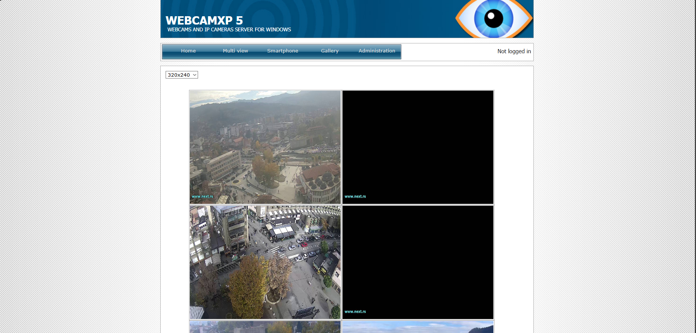

# Network-Walks-B084-Projects - Week 2: Project Module 2 (W2-PM2)

## Footprinting & Reconnaissance Attacks with GHDB (Google Hacking Database)

This project module explores passive reconnaissance and footprinting techniques using the Google Hacking Database (GHDB)[cite: 4, 12]. By leveraging advanced Google search operators (Google dorks), security researchers can identify exposed devices, open directories, and sensitive documents without directly touching the target network[cite: 4, 12].

---

## Project Overview & Background

Reconnaissance is the crucial first stage of any security assessment[cite: 12]. Utilizing GHDB allows pentesters and defenders to discover unintended information leaks such as:
* Exposed security camera feeds[cite: 4]
* Open directories and file listings[cite: 4, 9]
* Login portals and administrative panels[cite: 4, 6]
* Configuration files and downloadable resources[cite: 4]

Because these queries rely entirely on Google's public indexing crawler, the target organization is never directly contacted, making this form of footprinting completely passive and stealthy[cite: 12].

---

## Tasks & Execution

### Task 1: Finding Exposed Security Cameras
Using specific GHDB dorks such as `intitle:"webcamXP" inurl:8080`, live exposed camera feeds accessible via the public internet can be located[cite: 7, 8].

* **Example Dork:** `intitle:"webcamXP" inurl:8080`[cite: 8]
* **Sample Target Link:** `http://122.116.41.8:8080/`[cite: 8]

#### Visual Reference: Google Dorking & Webcam Exploitation
Below are screenshots demonstrating the Google Dorking search process and the resulting live webcam interface discovery:

---

### Task 2: Finding Downloadable Mathematics Ebooks
Using directory listing dorks like `intitle:index.of "parent directory" mathematics pdf`, researchers can locate public repositories containing educational resources and documents[cite: 9, 10].

* **Example Dork:** `intitle:index.of "parent directory" mathematics pdf`[cite: 10]
* **Sample Target Link:** `https://www.skylineuniversity.ac.ae/pdf/math/`[cite: 10]

---

## Disclaimer

*These materials are for educational and research purposes only. Do not use any techniques learned here against systems or networks without explicit written permission. Unauthorized access is illegal.*
