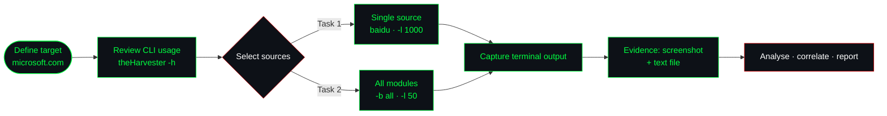

<div align="center">

```text
╔══════════════════════════════════════════════════════════════════╗
║  W2-PM4 :: PASSIVE RECONNAISSANCE & OSINT HARVESTING             ║
║  target   : microsoft.com        tool    : theHarvester 4.10.1   ║
║  platform : Kali Linux           mode    : passive (no contact)  ║
╚══════════════════════════════════════════════════════════════════╝
```

# 🛰️ Footprinting & Reconnaissance with theHarvester

**Network Walks · Week 2 · Project Module 4**
*Passive OSINT collection of email addresses, sub-domains and hosts for an external attack-surface assessment*

<br>


</div>

---

## 📑 Table of Contents

1. [Executive Summary](#-executive-summary)
2. [Scope & Rules of Engagement](#-scope--rules-of-engagement)
3. [Lab Environment](#-lab-environment)
4. [Methodology](#-methodology)
5. [Task 1 — Baidu Source, Limit 1000](#-task-1--baidu-source-limit-1000)
6. [Task 2 — All Sources, Limit 50](#-task-2--all-sources-limit-50)
7. [Comparative Analysis](#-comparative-analysis)
8. [Threat Model: How an Attacker Uses This Data](#-threat-model-how-an-attacker-uses-this-data)
9. [MITRE ATT&CK Mapping](#-mitre-attck-mapping)
10. [Defensive Recommendations](#-defensive-recommendations)
11. [Reproducing This Lab](#-reproducing-this-lab)
12. [Repository Structure](#-repository-structure)
13. [References](#-references)
14. [Disclaimer](#-disclaimer)

---

## 🎯 Executive Summary

External reconnaissance is the first phase of almost every intrusion, and it is the phase a target is least able to see. This module uses **theHarvester**, an OSINT aggregator written in Python, to enumerate publicly exposed **email addresses, sub-domains and hosts** belonging to `microsoft.com` from third-party data sources, without sending a single packet to the target's infrastructure.

Two runs were performed:

| Run | Sources | Result limit | Purpose |
|:---:|:---|:---:|:---|
| **Task 1** | `baidu` (single source) | `1000` | Measure what one search engine reveals in isolation |
| **Task 2** | `all` (every supported module) | `50` | Measure breadth of coverage and the effect of API-key gating |

**Key takeaways**

- A single source produced very little: **1 email, 0 IPs, 0 hosts** from Baidu. Single-source recon gives a dangerously incomplete picture in either direction, so a clean result from one source is not evidence of a small attack surface.
- Running `-b all` surfaced a practical constraint: many modules (BeVigil, Bitbucket, BufferOverrun, BuiltWith, Brave and others) **fail without API keys**. Real-world coverage depends on keyed intelligence sources, and an unconfigured tool silently under-reports.
- The one harvested address was a **system mailbox (`noreply`)**, which has low direct phishing value but still confirms a product-specific mail namespace that an attacker can pivot from.

---

## 🧭 Scope & Rules of Engagement

| Item | Detail |
|:---|:---|
| **Target domain** | `microsoft.com`, designated by the course brief as the exercise target |
| **Technique class** | Passive OSINT only: queries go to public search engines and intelligence APIs, not to the target |
| **Active flags used** | None. `-n` (DNS lookup), `-c` (DNS brute force), `-t` (takeover check) and `-s` (Shodan) were **not** enabled |
| **Intrusive activity** | None. No scanning, no authentication attempts, no exploitation |
| **Purpose** | Education and defensive understanding of what an adversary can learn without authorisation |

> [!IMPORTANT]
> Passive collection still demands discipline. On a real engagement, scope, data-handling rules and written authorisation are agreed **before** any collection, and harvested personal data (names, emails) is stored and destroyed according to the engagement's data-protection terms.

---

## 🖥️ Lab Environment

| Component | Value |
|:---|:---|
| Operating system | Kali Linux (virtualised lab) |
| Tool | theHarvester **4.10.1** (Christian Martorella, Edge-Security Research) |
| Config read at runtime | `/etc/theHarvester/proxies.yaml`, `/etc/theHarvester/api-keys.yaml` |
| Network posture | Outbound internet only; no proxy configured |
| Interface | Terminal (`bash`), launched via the Kali application menu |

---

## 🔬 Methodology



### Command-line reference

| Flag | Meaning | Used here |
|:---:|:---|:---:|
| `-d` | Target domain or company name | ✅ |
| `-l` | Limit on search results (tool default: `500`) | ✅ |
| `-b` | Data source (`baidu`, `crtsh`, `virustotal`, `all`, ...) | ✅ |
| `-f` | Save results to XML and JSON | ➖ optional |
| `-n` | DNS lookup on discovered hosts | ❌ (active) |
| `-c` | DNS brute force | ❌ (active) |
| `-t` | Subdomain takeover check | ❌ (active) |
| `-s` | Query Shodan for discovered hosts | ❌ |
| `-r` | DNS resolution with a resolver list | ❌ (active) |

> The usage banner on the lab host listed more than 40 supported sources, including `baidu`, `bevigil`, `bitbucket`, `brave`, `bufferoverun`, `builtwith`, `censys`, `certspotter`, `crtsh`, `dnsdumpster`, `duckduckgo`, `github-code`, `hunter`, `intelx`, `otx`, `rapiddns`, `securityscorecard`, `shodan`-adjacent modules, `urlscan`, `virustotal`, `waybackarchive` and `zoomeye`.

---

## 🅰️ Task 1 — Baidu Source, Limit 1000

**Objective:** Find email IDs and sub-domains for `microsoft.com` using the Baidu search engine with a result ceiling of 1000.

```bash
theHarvester -d microsoft.com -l 1000 -b baidu
```

### Result

```text
[*] Target: microsoft.com
[*] Searching Baidu.
[*] No IPs found.
[*] Emails found: 1
----------------------
viva-noreply@microsoft.com
[*] No hosts found.
```

| Artefact | Count |
|:---|:---:|
| Emails | **1** |
| IP addresses | **0** |
| Hosts / sub-domains | **0** |

### 📸 Evidence

<div align="center">


*Figure 1: theHarvester 4.10.1 querying Baidu for `microsoft.com` with `-l 1000`.*

</div>

### Analysis

- **Low yield is expected.** Baidu's index skews toward Chinese-language content and does not crawl deeply for Western corporate email addresses. Raising `-l` to 1000 does not help when the source simply holds little relevant data. The limit is a ceiling, not a guarantee.
- **The finding is a role account.** `viva-noreply@microsoft.com` is an automated sender tied to the Microsoft Viva product line. It is not a person, so credential-stuffing or spear-phishing value is limited, but it confirms that product-level mail namespaces are indexed publicly and can seed further searches (for example, pivoting on `viva` across other sources).
- **No hosts returned.** Baidu is a general web search engine and not a DNS or certificate source, so empty host output here says nothing about the real sub-domain footprint.

---

## 🅱️ Task 2 — All Sources, Limit 50

**Objective:** Repeat the collection with every supported module and a result limit of 50.

```bash
theHarvester -d microsoft.com -l 50 -b all
```

### Observed runtime behaviour

On the lab host, `-b all` iterated through the modules sequentially. Several keyed modules aborted immediately with missing-credential errors:

| Module | Outcome | Cause |
|:---|:---:|:---|
| `bevigil` | ⚠️ Failed | Missing API key |
| `bitbucket` | ⚠️ Failed | Missing API key |
| `bufferoverun` | ⚠️ Failed | Missing API key |
| `builtwith` | ⚠️ Failed | Missing API key (`A Missing Key Error occurred`) |
| `brave` | ⚠️ Failed | Missing API key (Brave Search) |

Each failure follows the same pattern: *read `/etc/theHarvester/api-keys.yaml` → fail to process the search for `microsoft.com` → report the missing key*, then move on to the next module.

### 📸 Evidence

<div align="center">


*Figure 2: `-b all` run showing module-by-module execution and API-key failures.*

</div>

### Analysis

- **`all` is not the same as complete.** The flag invokes every module, but modules that need credentials contribute nothing until keys are supplied. An analyst who reads only the final tally would wrongly assume full coverage.
- **Free sources carry the load.** Without keys, results depend on keyless providers such as certificate transparency logs (`crtsh`), passive DNS aggregators and web archives. Those are the sources most likely to reveal sub-domains.
- **A low `-l` is a trade-off.** A limit of 50 keeps run time short but truncates large namespaces like `microsoft.com`. For a real assessment, raise the limit, supply keys and run per-source so output can be attributed and de-duplicated.

> 💾 Raw output is stored in [`Output/`](Output/) alongside the screenshots.

---

## ⚖️ Comparative Analysis

| Dimension | Task 1 · `baidu` | Task 2 · `all` |
|:---|:---|:---|
| Sources queried | 1 | Every supported module |
| Result limit | 1000 | 50 |
| Depth per source | High ceiling, low yield | Shallow ceiling, wide coverage |
| Failure mode | Source simply lacks the data | Keyed modules abort without credentials |
| Runtime | Seconds | Noticeably longer (sequential modules) |
| Best used for | Validating one provider's index | First-pass breadth enumeration |
| Operational lesson | Never trust one source | Configure `api-keys.yaml` before trusting `all` |

**Conclusion:** neither run alone is sufficient. A defensible recon workflow combines **breadth** (many sources) with **depth** (higher limits on the sources that perform best) and records which modules actually ran.

---

## 🧨 Threat Model: How an Attacker Uses This Data

The brief states the core idea plainly: each harvested email is a possible target for phishing and password attacks, and each sub-domain is another door into the organisation. Mapped to an attack chain:

| Harvested data | Adversary use | Downstream impact |
|:---|:---|:---|
| Email addresses | Phishing target lists, password spraying, user-enumeration against SSO or OWA | Credential compromise, initial access |
| Email naming convention | Predict valid addresses for staff not publicly listed | Wider target pool |
| Sub-domains | Find forgotten, staging or legacy systems with weaker controls | Exploitable entry point, takeover candidates |
| Hosts / IPs | Seed for later active scanning | Service discovery, vulnerability targeting |

Because every query goes to a third party, **the target never sees the reconnaissance**. That is why passive recon is hard to detect, and why defenders run the same tooling against themselves.

---

## 🗺️ MITRE ATT&CK Mapping

| Tactic | Technique | ID | Relevance |
|:---|:---|:---:|:---|
| Reconnaissance | Gather Victim Identity Information: Email Addresses | `T1589.002` | Email harvesting |
| Reconnaissance | Gather Victim Network Information: DNS | `T1590.002` | Sub-domain and host discovery |
| Reconnaissance | Search Open Websites/Domains | `T1593` | Baidu, DuckDuckGo, Brave and similar engines |
| Reconnaissance | Search Open Technical Databases | `T1596` | crt.sh, passive DNS, certificate transparency |
| Resource Development / Initial Access | Phishing (consumer of this data) | `T1566` | Follow-on use of harvested addresses |

---

## 🛡️ Defensive Recommendations

Findings are framed as an organisation would act on them after running this tool against its own domain.

| # | Control | Rationale | Priority |
|:-:|:---|:---|:---:|
| 1 | **Run theHarvester against your own domains on a schedule** with keyed sources enabled | See exactly what an adversary sees; track change over time | 🔴 High |
| 2 | **Enforce SPF, DKIM and DMARC (`p=reject`)** | Blunts phishing that impersonates harvested addresses | 🔴 High |
| 3 | **Maintain a sub-domain inventory** and decommission stale DNS records | Removes forgotten assets and takeover candidates | 🔴 High |
| 4 | **Monitor certificate transparency logs** for unexpected certificates | Detects shadow IT and rogue issuance early | 🟠 Medium |
| 5 | **Reduce public email exposure**: use contact forms and role aliases rather than named addresses | Shrinks the harvestable pool | 🟠 Medium |
| 6 | **Enforce MFA and conditional access** on all externally reachable identity surfaces | Makes harvested emails far less useful for password attacks | 🔴 High |
| 7 | **Phishing-awareness training** informed by the real harvested list | Targets the staff an attacker would actually reach | 🟠 Medium |
| 8 | **Review public code and paste sites** (`github-code`, `bitbucket` modules) for leaked addresses and secrets | Catches accidental disclosure | 🟡 Routine |

---

## 🔁 Reproducing This Lab

```bash
# 1. Confirm the tool and read usage
theHarvester -h

# 2. Task 1 – single source, 1000 results
theHarvester -d microsoft.com -l 1000 -b baidu | tee Output/task1-baidu.txt

# 3. Task 2 – all sources, 50 results
theHarvester -d microsoft.com -l 50 -b all | tee Output/task2-all.txt

# 4. Optional – structured export (writes .xml and .json)
theHarvester -d microsoft.com -l 50 -b crtsh,duckduckgo -f Output/microsoft-structured
```

**Notes**

- `-f` produces **XML and JSON**; use `tee` (as above) when a plain text file is required.
- Supply keys in `/etc/theHarvester/api-keys.yaml` to unlock keyed modules.
- Results drift over time because upstream sources change their indexing and algorithms. Your output may differ while the method stays identical.
- Installing outside Kali:

```bash
sudo apt-get install theHarvester
# or
git clone https://github.com/laramies/theHarvester.git
cd theHarvester
sudo python ./theHarvester.py
```

---

## 🗂️ Repository Structure

```text
Week2/
└── W2-PM4/
    ├── README.md
    ├── Assets/
    │   ├── task1-baidu-output.png
    │   └── task2-all-sources-output.png
    └── Output/
        ├── task1-baidu.txt
        └── task2-all.txt
```

---

## 📚 References

- [theHarvester on GitHub](https://github.com/laramies/theHarvester)
- [MITRE ATT&CK: Reconnaissance (TA0043)](https://attack.mitre.org/tactics/TA0043/)
- [Network Walks](https://www.networkwalks.com)

---

## ⚠️ Disclaimer

This repository documents work completed in a training environment for **education and defensive research only**. `microsoft.com` was used as the course-designated target with passive, public-source queries exclusively. Do not run reconnaissance against any organisation without the owner's written authorisation. Unauthorised access is a criminal offence in most jurisdictions.

---

<div align="center">

**Author:** Kitsana Thuekoh · Offensive Security Researcher
[](https://github.com/vetementsvmnts)

`>_ know what you leak before someone else does.`

</div>
